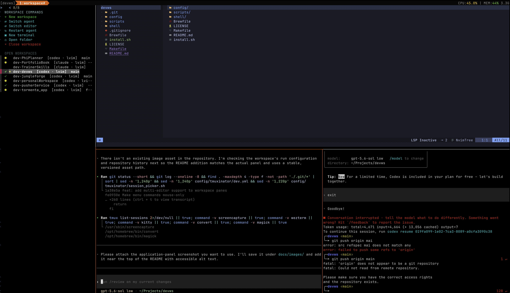

# devws

`devws` turns each project into a terminal workspace that survives restarts:
an editor (Neovim with LazyVim, Vim, VS Code or Zed), a coding agent (Claude
Code or Codex) and a terminal side by side, one tmux session per branch.
Around them:

- a sidebar of the open workspaces, with each one's branch, changes, pull
  request and agent state, and a menu with every action (`C-b Space`);
- GitHub as the source: pick a repo, and each task gets a branch in a folder
  of its own; commit, push and open the PR from the menu;
- several agents and accounts at once, with their state, plan limits and an
  optional shared long-term memory (ai-memory);
- branches run in Docker through jungleforge, with long work as background
  jobs that never block the screen;
- a database pane, two layouts, panels that minimize, and a header with the
  machine, the network and the weather.



## Requirements

The automatic dependency installer supports macOS and Linux systems with
[Homebrew](https://brew.sh).

Core dependencies:

- Bash and Zsh
- Git
- tmux 3.2 or newer
- tmuxinator
- fzf
- Glow
- [devdb](../devdb) for the database pane, installed with
  [uv](https://docs.astral.sh/uv/) from its checkout (`~/Projects/devdb`, or
  `DEVWS_DEVDB_SOURCE`)
- Neovim 0.11.2 or newer, set up with [LazyVim](https://www.lazyvim.org)
- ripgrep, fd, and the tree-sitter CLI (used by LazyVim)
- `tree`
- Ruby (used by tmuxinator)
- one AI agent: [Claude Code](https://docs.anthropic.com/en/docs/claude-code)
  or [Codex](https://developers.openai.com/codex/)

The included tmux theme uses
`JetBrainsMono Nerd Font Mono`. The Brewfile installs the font on macOS, but
you must select it in your terminal profile.

Optional GUI integrations are Finder (macOS), Zed, and VS Code. The menu hides
no errors if Zed or VS Code is unavailable; those actions simply do nothing.

Vim, VS Code, and Zed are optional alternate editors. Only Neovim is installed
by the dependency installer; picking another editor requires it to already be
on `PATH`.

LazyVim needs no separate install: `~/.config/nvim` links to `config/nvim`,
and the first `nvim` start downloads LazyVim, its plugins, language servers and
parsers. Plugin versions are pinned by `config/nvim/lazy-lock.json`; update them
with `:Lazy update` and commit the lock file to move every machine forward.
devws no longer uses LunarVim. Installing removes the old devws links in
`~/.config/lvim` and restores what was there before; uninstall LunarVim
yourself if you no longer need it.

### Shift+Enter in iTerm2

iTerm2 sends a plain carriage return for both Enter and Shift+Enter, so nothing
downstream — shell, tmux, or agent — can tell them apart, and Shift+Enter
submits instead of inserting a newline. The installer offers to fix this, or
run it on its own:

```sh
./install.sh --iterm-keys   # or: make install-iterm-keys
```

**Quit iTerm2 first.** It keeps its preferences in memory and rewrites them on
quit, which would discard the change. Reopen iTerm2 afterwards to pick it up.

The mapping sends `ESC CR` (hex `0x1b 0x0d`, the same bytes as Option+Enter) for
Shift+Enter, added to iTerm2's global key map alongside its built-in bindings. If
an agent ignores it, `scripts/setup_iterm_keys.sh` documents two alternatives at
the top: `0x0a` (Ctrl-J) and the CSI-u sequence `[13;2u`. `delete.sh` removes the
mapping again.

## Install

Clone the repository, then run:

```sh
./install.sh --deps
source ~/.zshrc
```

`fzf` is required for the workspace picker and is checked on every install. If
it is missing, the installer asks permission before installing it with
Homebrew and stops without changing configuration when permission is denied.

Every install upgrades an outdated Homebrew-managed tmuxinator automatically.
A tmuxinator installed by another package manager is left unchanged. `--deps`
installs the Brewfile and tmux plugin manager. If your other
dependencies are already installed, use `./install.sh`.

The installer creates symlinks into the clone. Keep the cloned folder in its
original location after installation. Existing managed files are moved to a
timestamped directory under `~/.devws-backups/` before replacement.

`devws` itself is a command on your PATH (`~/.local/bin/devws`, a link to
`bin/devws`), so every pane runs the checkout's current version, and each run
links any devws script an update added to `~/.tmuxinator` — after a `git
pull`, there is nothing to reinstall or reload. When installation finishes,
run the reload command it prints once, for the prompt and editor settings
(`shell/devws.zsh`):

```sh
source ~/.zshrc
```

Panes opened before devws became a command keep the old shell function until
they are reopened (or run `source ~/.zshrc` in them).

The installer also offers to log in to GitHub (`gh auth login`), which
[GitHub workspaces](docs/guide/workspaces.md) need. gh asks how git should reach
GitHub: **SSH** clones with your SSH key, **HTTPS** lets gh log git in too.
To change it later, run `gh config set git_protocol ssh` (or `https` followed
by `gh auth setup-git`). Skip the login and only `devws` with no folder is
unavailable until you run `gh auth login`.

It then offers two optional parts, each asked once (`--ai-memory` or
`--jungleforge` asks again after a no):

- [ai-memory](docs/guide/agents.md#agent-memory-ai-memory), long-term memory
  shared by your agents;
- [jungleforge](docs/guide/app.md#set-up-jungleforge), which runs your
  branches' apps in Docker: it is cloned into `~/.devws/jungleforge` with a
  `.env` of generated passwords. It needs Docker Desktop.

Install either Codex or Claude Code separately, authenticate it, and edit
`config/tmuxinator/.env` if you want to change the available/default agent or
editor.

## Using devws

```sh
devws                    # the start screen: a recent folder, or a new branch of a GitHub repo
devws ~/Projects/my-app  # a workspace on a folder
```

Then `C-b Space` opens the menu, with every action in tabs and each one's
key. Everything devws does is in the guide, which also opens from the
menu's **Help** tab and with `devws help [page]`:

- [Start here](docs/guide/README.md): the screen and the first workspace
- [Workspaces](docs/guide/workspaces.md): the start screen, GitHub branches,
  worktrees, closing, detaching, tidy, restore after a restart, pausing
- [Layout](docs/guide/layout.md): layouts, panels, minimize, the header, the
  editor, following the agent
- [Agents](docs/guide/agents.md): agents and accounts, status, ai-memory
- [Git](docs/guide/git.md): commit, push and pull requests
- [App](docs/guide/app.md): running branches in jungleforge, the database
  pane, background jobs
- [Shortcuts](docs/guide/shortcuts.md) · [Commands](docs/guide/commands.md) ·
  [Configuration](docs/guide/configuration.md)

## Update devws

```sh
git pull && ./install.sh
```

`./install.sh` ends by reloading the open workspaces when tmux is running, so
the update applies at once, without restarting tmux or losing the agents'
conversations. `devws reload` does the same by hand:

- reloads `~/.tmux.conf` (formats, key bindings, colors; the header's ticker
  restarts with it);
- restarts each workspace's sidebar and minimized placeholders, so they run
  the new scripts (the working agents' spinner turns in the header's ticker,
  which restarts with tmux.conf);
- leaves the agent, editor, terminal and database panes running.

What those read only when they start applies to new or restarted ones: the
agents' hooks and status line (`agent_settings.json`; **↻ Restart agent** in
the devws menu), the editor config, and the per-workspace options `dev.yml`
sets, such as the workspace name on the status bar (reopen the workspace).
Sessions that are not devws workspaces are left alone, apart from tmux.conf,
which is global.

## Validate

```sh
make check                   # everything, a few minutes
scripts/check.sh --quick     # syntax and the fast suites, under 30 seconds
```

This checks Bash/Zsh syntax, the tmuxinator ERB/YAML template, Lua syntax of
the Neovim config when `luac` is available, and executable permissions, then
runs every test suite in `scripts/` (`test_*.sh`), four at a time
(`DEVWS_CHECK_JOBS`), printing `✓`/`✗` per suite and the full output of any
that fails. The suites drive isolated tmux servers, including real mouse
clicks, and never touch your own workspaces.

## Uninstall

Run:

```sh
./delete.sh
source ~/.zshrc
```

During installation, devws records its backup state before replacing any
configuration. The uninstall script removes the configuration symlinks
created by this checkout, restores the files that were in their place before
installation, and removes the shell integration from `~/.zshrc`.

The saved workspace state in `~/.devws-state/` is removed, and the iTerm2
Shift+Enter mapping is deleted when devws is the one that added it. Quit iTerm2
before uninstalling so that removal can take effect.

Files that are no longer devws-managed are left untouched. If one conflicts
with a configuration that needs to be restored, the previous configuration
remains in `~/.devws-backups/` and the script reports its location. Only empty
configuration directories are removed.

If devws installed `fzf` after receiving permission or installed Glow through
`./install.sh --deps`, `delete.sh` removes those owned packages. Pre-existing
installations are never removed. Other dependencies installed with `--deps`
are preserved because Homebrew packages and tmux plugin manager may
be shared with other tools or may have existed before devws. Remove those
separately only if they are no longer needed.

The installer and uninstaller never modify Git remotes or GitHub
configuration.
